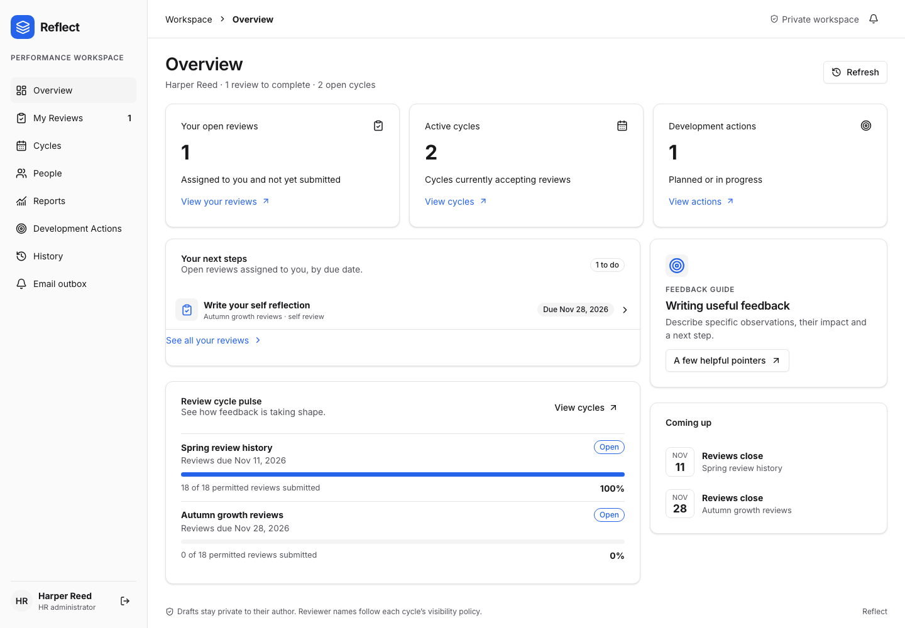
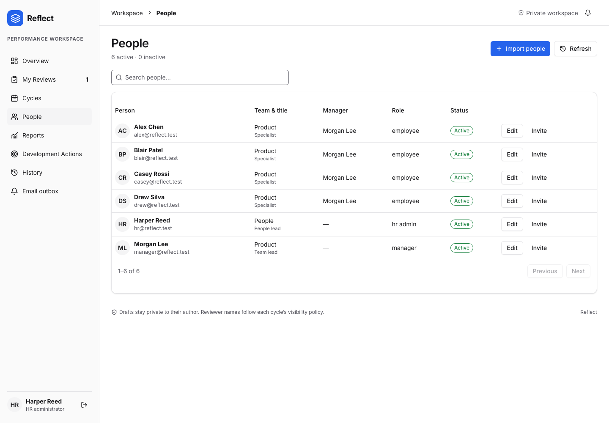
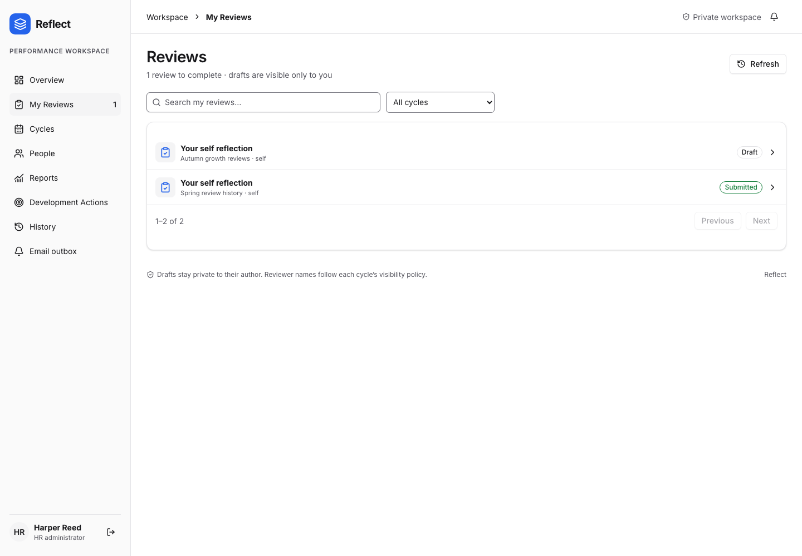

# Reflect

A performance review app for HR, managers and employees, inspired by Lattice and built with [Neander](https://neander.ai).



Plan review cycles, collect self/manager/upward/peer feedback, calibrate summaries, release results and track development actions. Reflect includes role-scoped access, private drafts, versioned result packets, acknowledgments, CSV imports, privacy-aware reports, CSV/PDF exports and an email outbox.

This repository is a reusable Neander template and a standalone Next.js application. Using it in Neander copies a registered source revision into a normal project with fresh Git history. Normal Publish deploys the app with its database migrations and fictional sample data; subsequent prompting, code edits and republishing use the usual project workflow. Existing projects do not automatically receive later template changes.

Reflect is not affiliated with Lattice. [Source provenance](docs/source-provenance.md) records the delivered source revision and attribution.

## Run locally

Use Node **24.22.3**, pnpm **11.18.0**, and Docker for PostgreSQL. No email provider or scheduler account is needed to explore the app.

```sh
corepack enable
pnpm install --frozen-lockfile
cp .env.example .env.local
docker compose -p reflect-dev -f compose.dev.yaml up -d --wait
set -a
. ./.env.local
set +a
pnpm db:migrate
pnpm db:seed
pnpm dev
```

Open <http://127.0.0.1:3000/login>. The sample workspace ID is **`reflect-demo`**:

| Role | Email |
| --- | --- |
| HR | `hr@reflect.test` |
| Manager | `manager@reflect.test` |
| Employee | `alex@reflect.test` |

The local example password is `Reflect-demo-2026!`, configured by `DEMO_PASSWORD`. In Neander, `DEMO_PASSWORD` is generated per deployment; the project owner uses that deployment's configured value. These are fictional `.test` accounts. Use your own accounts/passwords before storing real employee data.

Try Overview → Cycles, open Autumn growth reviews, review People, or sign in as Alex to inspect a private draft and released review history. Re-running `pnpm db:seed` preserves the entire existing sample workspace, including edited records and passwords. It does not import any delivered production workspace data.

Local Compose is separate from the production recipe. Stop only this project's database with `docker compose -p reflect-dev -f compose.dev.yaml down`; omit `--volumes` to preserve local data.

## Publishing configuration

`.neander/compose.yaml` is the canonical normal-Publish recipe. It uses PostgreSQL/Neon, `nextjs-drizzle` migrations and the standalone production image. Migrations and sample seeding run as explicit setup steps, not on every server startup.

| Setting | Source |
| --- | --- |
| `DATABASE_URL` | Provisioned PostgreSQL/Neon |
| `APP_ORIGIN` | Provisioned public app origin |
| `AUTH_TOKEN_KEY`, `HR_SETUP_KEY`, `SCHEDULER_SECRET`, `DEMO_PASSWORD` | Generated independently per deployment |
| `EMAIL_PROVIDER`, `EMAIL_API_KEY`, `EMAIL_FROM` | Optional owner-configured Resend/Brevo account and verified sender |
| `CRON_SECRET` | Optional owner-configured scheduler secret, at least 32 characters |

Email remains visibly disabled until configured. Invitations and password recovery need an email provider. The in-process timer runs only while the app has CPU; scale-to-zero deployments need an owner-controlled scheduler to POST `/api/jobs` with a bearer `CRON_SECRET` or `SCHEDULER_SECRET`. The template neither ships provider credentials nor creates external jobs. See [operations and recovery](docs/handover.md).

To start a new empty workspace instead of using the fictional team, use **Set up a new workspace** on the login page with your deployment's `HR_SETUP_KEY`.

## Verify changes

```sh
pnpm check
pnpm test
pnpm build
node tests/standalone-artifacts.mjs
```

The application suite exercises real disposable disk-backed PGlite/PostgreSQL-compatible storage, role/privacy policies, conflict handling, workflow transitions, email rendering and backup/restore with mocked email delivery. Production always requires PostgreSQL; the embedded database is restricted to synthetic local/testing use.

`pnpm test:template` is the production-image test used by template verification. It requires the shared verifier's disposable database, generated environment bundle and `NEANDER_TEMPLATE_IMAGE`; it checks browser login, populated data, HR/manager/employee permissions, repeat seeding and edit persistence across container restart. The public GitHub workflow runs the same test against native Linux/amd64 with PostgreSQL. Neander's private publisher additionally verifies the exact committed source and uploads registered releases; no private tooling or cloud credentials live here.

See [verification scope](docs/status.md) for provider and hosted-environment limits.

## Screenshots




## License

MIT. Existing third-party UI foundation notices are retained in [public/neander-foundation-LICENSE.txt](public/neander-foundation-LICENSE.txt).
